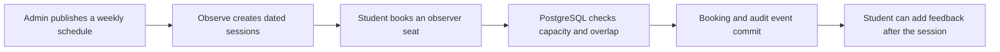

# Observe

**A self-hosted booking portal for teacher-training classroom observations.**

Observe lets academy staff publish class schedules, teacher-training students reserve observation seats, and TTC Masters review bookings and feedback. It uses Next.js, TypeScript, PostgreSQL, and Prisma, with a Jalali calendar for the `Asia/Tehran` time zone.

[Local setup](#quick-start) · [Verification](#verification) · [Deployment guide](deploy/DEPLOYMENT.md)

## What each role can do

| Role | Workflow |
| --- | --- |
| Student | Sign in with a private access code, book a session, manage reservations, and submit feedback after the session. |
| Administrator | Manage accounts and classes, publish recurring schedules, and preview the impact of schedule changes. |
| TTC Master | Review schedules, booking history, feedback, and audit activity with read-only access. |

## How booking works



Each session has one observer seat. Students can book multiple distinct, non-overlapping sessions. The student cancellation window closes at the earlier of 30 minutes after booking or the session start. Administrators can override cancellations. All dates shown in the portal use the Jalali calendar with English labels.

## Quick start

Requires Node.js 24 LTS. From this directory:

```bash
npm ci
npm run db:generate
npm run db:local
```

The last command starts an isolated, loopback-only PostgreSQL 16 cluster on port **55439** and remains running. It writes generated local credentials to ignored `.local/development.env` (never prints the password). It does not use or modify an existing PostgreSQL installation. The embedded test-runner wrapper has a prerelease package label; deployed production uses Ubuntu's PostgreSQL service.

In a second terminal:

```bash
node --env-file=.local/development.env node_modules/prisma/build/index.js migrate deploy
node --env-file=.local/development.env --import tsx scripts/admin.ts
node --env-file=.local/development.env --import tsx scripts/seed.ts
node --env-file=.local/development.env node_modules/next/dist/bin/next dev --hostname 127.0.0.1 --port 3100
```

Open [http://127.0.0.1:3100](http://127.0.0.1:3100). Choose **School administrator? Sign in** and use the admin credentials you created interactively. No default users or passwords are shipped. Seeding is optional and creates sample classes.

Alternatively use your own local PostgreSQL instance: copy `.env.example` to `.env`, set `DATABASE_URL`, `DIRECT_URL`, and `APP_ORIGIN`, then run `npm run db:migrate`, `npm run admin`, and `npm run dev`. Passwords containing special characters must be URL-encoded.

## First school workflow

1. Open Students → Add student. Copy the access code shown once and send it manually. The database retains only its SHA-256 hash.
2. Open Classes → Create class. Set the level/class name, teacher, and classroom/location.
3. Publish a schedule using Jalali start/end dates and one or more selected weekdays/time slots. Each dated occurrence automatically has one observer seat.
4. Students sign in using their access code, view class level, teacher, location, date, and time, then book an available observation. Their history displays the cancellation deadline.
5. Use the student's History action for a filtered audit timeline. New code replaces a credential and signs the student out; Revoke disables code access until a new code is generated.

Archiving preserves history. Archiving a student cancels future bookings; a class must have its future sessions cancelled before archival. Deactivation blocks access and retains reservations.

## Recurring schedule edits

Schedules have finite date ranges, at most two years, and independent weekly slots. Sessions are materialized when a rule is published. Rule changes from an effective date pair editable future occurrences chronologically, retaining session IDs and booking IDs; unmatched old sessions are cancelled and additional occurrences are created. The preview lists the exact moves and cancellations. Past sessions and individually edited/cancelled exceptions remain protected. A changed time for a same-day slot preserves its corresponding individual exception.

Individual session edits preserve reservations and the original cancellation clock. Every session is constrained to exactly one observer seat, and schedule changes that overlap a booked student's other sessions are rejected atomically. Preview fingerprints detect intervening changes; stale previews must be refreshed.

## Structure

```text
src/app/          Next.js entrypoints, route handlers, global styles
src/components/   Student/admin workspace and accessible Jalali picker
src/lib/          Shared calendar rules and time conversion
src/server/       Authentication, validation, transactional services
prisma/           Database schema and checked-in migrations
scripts/          Interactive admin setup, local DB, test setup, sample courses
tests/            Calendar unit, real PostgreSQL integration, browser workflows
deploy/           Ubuntu runbook, per-site Nginx, systemd, backup tooling
```

## Verification

```bash
npm test
npm run typecheck
npm run build
node --env-file=.local/development.env --import tsx scripts/production-smoke.ts
node --env-file=.local/development.env --import tsx scripts/prepare-test-db.ts
node --env-file=.local/development.env --import tsx --test tests/db/booking.test.ts
```

For browser tests, leave the local database running, stop any app already using port 3100, and start the dedicated test server in another terminal:

```bash
node --env-file=.local/development.env --import tsx scripts/e2e-server.ts
```

Then:

```bash
node --env-file=.local/development.env node_modules/@playwright/test/cli.js test
```

Browser tests use installed Google Chrome for desktop/mobile emulation and different browser timezones. Install Chrome first if unavailable. They create random test accounts and verify booking/cancellation through the UI and database. Screenshots are saved under ignored `test-results/`. Database test runners reject remote hosts and every database name other than `lingua_test`; the application development database is separate. Test fixtures retain history and use unique identities, allowing repeated runs without deleting audit records. Never run these tests against production.

## API and security

All API responses use `Cache-Control: no-store`:

- `POST /api/auth/login`: `{code}` for students or `{email,password}` for admins; sets a secure production HTTP-only session cookie.
- `POST /api/auth/logout`: ends the current browser session.
- `GET /api/workspace?start=JALALI_DATE&end=JALALI_DATE&page=1&student=UUID&q=ACTION`: role-filtered workspace and paginated audit data; end date is exclusive.
- `GET /api/bookings?state=Upcoming&page=1`: paginated history (30 records/page); states are `Upcoming`, `Past`, and `Cancelled` (`Completed` remains a compatibility alias). Optional `q` searches class/teacher, and inclusive Jalali `start`/`end` dates filter before pagination. Staff may filter by a `student` UUID. Students always see only their own records. Responses include full-scope `counts`, `next`, an optional `feedbackPrompt`, and `serverNow`.
- `POST /api/commands`: validated discriminated command body. Supported `action` values and exact input types are defined in `src/server/validation.ts`.
- `GET /api/health/live` and `/api/health/ready`: application and database readiness.

Commands cover user creation/update/archival; code replacement/revocation; class creation/update/archival; schedule publication; occurrence editing/cancellation; booking and booking cancellation. Previewable commands require `preview:true`, then `preview:false` plus the returned `fingerprint`. Booking requests include a client-generated UUID `requestKey` for retries. Errors have `{error:string}` and appropriate HTTP status codes.

Every mutation requires the exact configured Origin and an active authorized session. Node must remain behind trusted Nginx on loopback; Nginx overwrites client-IP headers for persistent throttling. Access codes and session IDs are random 256-bit values with only hashes stored. Admin passwords use Argon2id. Admin and TTC Master sessions expire after 8 hours, student sessions after 24 hours; **student access codes themselves never expire**. Expired sessions require entering the code again. Identity and role are checked server-side, including session revalidation inside mutation transactions.

PostgreSQL stores absolute instants in `timestamptz`. Driver connections use Tehran timezone; date math uses named-zone conversion, and ISO transport timestamps remain unambiguous absolute instants. Recurrence uses Tehran wall-clock time, not the browser's timezone. Do not replace named-zone handling with naive dates or a hardcoded offset.

Domain mutations and their audit events commit together. Audit records are append-only by trigger; the deployment guide also removes runtime UPDATE/DELETE privileges. A database transaction advisory lock coordinates identity, capacity, overlap, and schedule mutations. This deliberately favors correctness for a single school's workload; scale-out writes must retain this coordination or replace it with carefully ordered per-user/per-session locks and equivalent concurrency tests.

The initial CSP allows inline scripts/styles needed by the framework and component styling; development additionally allows eval for Next.js debugging. There are no third-party analytics or messaging services. Add a nonce-based CSP before introducing untrusted HTML or externally hosted scripts.

## Deploy

See the [Ubuntu deployment guide](deploy/DEPLOYMENT.md) for PostgreSQL, Nginx, systemd, backups, and rollback. Production builds use Next.js with Webpack. Development uses Turbopack.

## Observation hub, feedback, and TTC Master access

My observations provides a next-session panel, full-history totals, date-grouped cards, teacher/class search, inclusive Jalali date filters, and a reservation drawer. Student cancellations show a live countdown and require confirmation; server enforcement of the existing cancellation deadline is unchanged. Past sessions represent elapsed reservations, not verified attendance.

Students may write or edit optional feedback after a non-cancelled session ends. Feedback is plain text (1–4000 characters), visible to its author, admins, and TTC Masters. It is stored separately from bookings. Feedback changes and redacted audit metadata commit together; comment bodies are not duplicated in the audit log.

Admins create TTC Master accounts under **TTC masters → Add TTC master** and share the one-time-displayed private access code. Masters use the normal code sign-in screen. They can review students (including archived accounts), courses/schedules, available/reserved calendar sessions, observer names, per-student booking history, feedback, and audit activity. Every domain-changing command is denied server-side; authentication/sign-out still work normally. Admins can edit/deactivate/archive the account and rotate or revoke its code. Neither student nor master account forms can grant administrator privileges.

These features add the `BookingFeedback` table and the `TTC_MASTER` enum value through additive migrations. Existing users retain their roles, access codes, and bookings. Use migration-owner credentials, a verified backup and restore rehearsal, and a versioned release; never reset or seed the production database.
